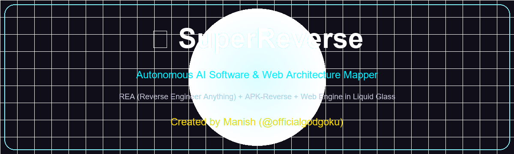
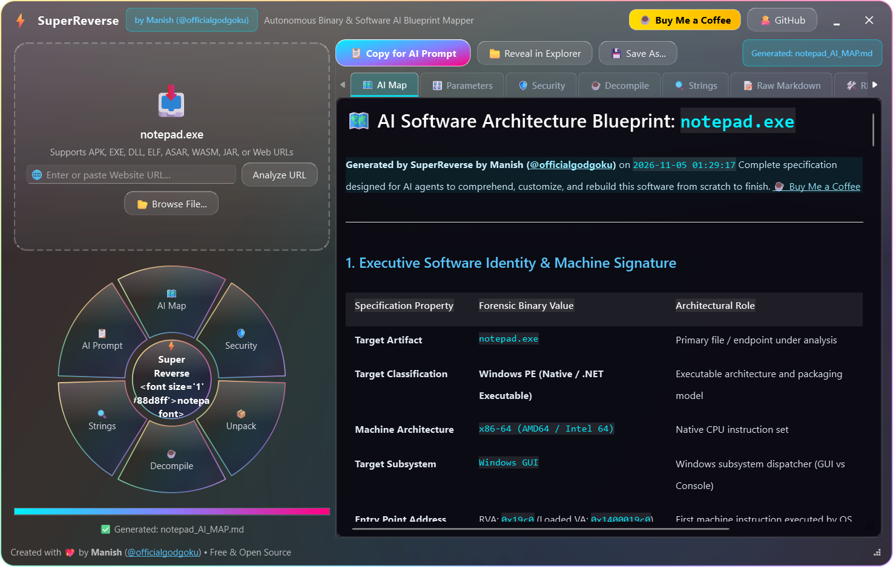
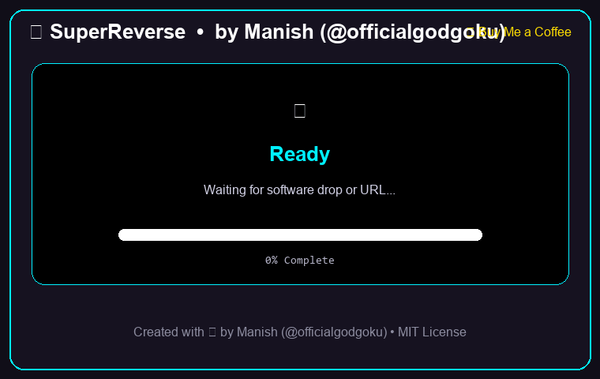

# SuperReverse

<p align="center">
  <br>
  <b>Autonomous Binary & Software AI Architecture Blueprint Mapper</b><br>
  <i>Created with 💖 by <b>Manish</b> (<a href="https://github.com/officialgodgoku">@officialgodgoku</a>)</i>
</p>

<p align="center">
  <a href="https://github.com/officialgodgoku/SuperReverse/releases/latest"></a>
  <a href="LICENSE"></a>
  <a href="https://www.python.org"></a>
  <a href="https://buymeacoffee.com/officialgodgoku"></a>
  <a href="https://github.com/officialgodgoku"></a>
</p>

---

## 🌟 Visual Showcase

Drop any binary executable, APK, JavaScript package, or live website URL onto **SuperReverse** to instantly scan the target at machine code level and throw out an **Autonomous AI Architecture Map (`<Target>_AI_MAP.md`)**:

<p align="center">
  
</p>

### 🎬 Live Multi-Engine Dynamic Pipeline
Watch SuperReverse disassemble machine instructions with Capstone, populate the Tweakable Parameter Matrix, and unpack resources in real time:

<p align="center">
  
</p>

---

## 🚀 Key Features

### 1. 📥 Fluid Drag-and-Drop Drop Zone
- **Universal Multi-Platform Support**:
  - 🤖 **Android Packages**: `.apk`, `.aab`, `.xapk`, and unpacked trees
  - 🪟 **Windows Native & .NET**: `.exe`, `.dll`, `.sys`, `.ocx` (x86, x64, ARM64)
  - 🌐 **Live Web Applications & URLs**: Any URL (`https://...`, `http://...`) or `.url` internet shortcuts
  - ⚡ **Electron & Node.js**: `.asar` archives, unpacked JavaScript applications
  - 🐧 **Linux**: ELF binaries, `.so` shared libraries (x86_64, ARM, RISC-V)
  - 🍎 **macOS / iOS**: Mach-O executables, universal fat binaries, `.dylib`
  - ☕ **Java & WebAssembly**: `.jar`, `.war`, `.wasm`
- **One-File Blueprint Output**: Generates `<Target>_AI_MAP.md` directly next to the source file or on your Desktop, giving any AI model all context required to rebuild or tweak the software from scratch to finish.

---

### 2. 🎛️ Interactive Liquid-Glass Radial Action Dial
Drop files directly onto any petal or click to dispatch dedicated reverse engineering workflows:
- 🗺️ **AI Map**: Generates full-spectrum architecture flowchart, sequence diagram, and reconstruction ledger.
- 🛡️ **Security**: Exploit mitigations audit (ASLR, DEP/NX, CFG, SafeSEH, Authenticode) and auto-generated Frida dynamic hooking scripts (SSL unpinning & root bypass).
- 📦 **Unpack**: Extracts embedded resources, icons, manifest XMLs, DEX files, and sections into `<Target>_unpacked/` and reveals the folder in Windows Explorer.
- ☕ **Decompile**: Full Capstone machine disassembly at entry point or JADX Java bytecode decompilation.
- 🔍 **Strings & Intelligence**: Discovers URLs, remote endpoints, IP addresses, Windows Registry keys, and secrets.
- 📋 **AI Prompt**: Copies a direct AI Prompt Injection block to clipboard with one click.

---

### 3. 🔬 7-Tab Architecture & Forensics Viewer

| Tab | Feature | Description |
| :--- | :--- | :--- |
| **🗺️ AI Map** | **Visual Blueprint** | Renders Mermaid flowcharts, execution sequence diagrams, forensic identity, and the AI Reconstruction Obligation Ledger. |
| **🎛️ Parameters** | **Tweakable Matrix** | Searchable table of every binary parameter, current value, location, and developer tweak guide. Includes **Copy JSON** and **Copy Markdown**. |
| **🛡️ Security** | **Exploit Defenses** | Mitigations table (ASLR, DEP/NX, CFG, SafeSEH, Authenticode, Android Debuggable, Cleartext), risk flags, and ready-to-run Frida scripts. |
| **☕ Decompile** | **Disassembly & Sources** | Capstone 5.x NASM disassembly with addresses, hex bytes, and mnemonics, plus recovered Java and Electron sources. |
| **🔍 Strings** | **Intelligence Harvester** | Filterable database of discovered endpoints, IPs, registry persistence paths, and secrets. |
| **📝 Raw Markdown** | **Blueprint Editor** | Raw markdown code editor with syntax highlighting, Save As, and direct export. |
| **🛠️ REA Environment** | **Tool Readiness** | Diagnostics dashboard checking REA CLI, JADX, APKTool, Frida, and Python runtime. |

---

## 🎛️ Complete Tweakable Parameter Matrix Example

SuperReverse extracts all binary parameters into a standardized table so developers or AI agents can easily tweak configuration values:

```markdown
| Parameter Identifier | Architectural Category | Current Binary Value | Discovered In | How to Tweak / Impact |
| :--- | :--- | :--- | :--- | :--- |
| `IMAGE_BASE` | Memory Architecture | `0x140000000` | `pe.OPTIONAL_HEADER.ImageBase` | Base memory loading address in virtual RAM |
| `ENTRY_POINT_RVA` | Execution Lifecycle | `0x19c0` | `pe.OPTIONAL_HEADER.AddressOfEntryPoint` | Relative entry point instruction address |
| `SUBSYSTEM` | Platform Subsystem | `Windows GUI` | `pe.OPTIONAL_HEADER.Subsystem` | Controls console window presence (GUI vs Console) |
| `STACK_RESERVE_BYTES` | Thread & Memory | `524288` | `pe.OPTIONAL_HEADER.SizeOfStackReserve` | Initial stack size reserved per thread |
| `HEAP_RESERVE_BYTES` | Thread & Memory | `1048576` | `pe.OPTIONAL_HEADER.SizeOfHeapReserve` | Initial default process heap reserve |
| `ASLR_ENABLED` | Exploit Defense | `True` | `DllCharacteristics:0x0040` | Randomizes base address at load time |
| `DEP_NX_ENABLED` | Exploit Defense | `True` | `DllCharacteristics:0x0100` | Prevents code execution from data/heap pages |
| `CFG_ENABLED` | Exploit Defense | `True` | `DllCharacteristics:0x4000` | Validates indirect branch targets |
```

---

## 🗺️ The Autonomous AI Software Blueprint (`*_AI_MAP.md`)

Each generated blueprint follows an exhaustive specification designed for AI coding models:
1. **Executive Identity & Machine Signature**: Format, platform, SHA-256 digest, size, entry points, and subsystem.
2. **System Architecture Flowchart (Mermaid)**: Visual architectural diagram mapping every layer from OS loader to UI stack.
3. **End-to-End Execution Sequence Diagram (Mermaid)**: Chronological message and data flow between components.
4. **Complete Tweakable Parameter & Configuration Matrix**: All discovered binary parameters with tweak instructions.
5. **Binary-Level Forensic Observations & Machine Code**: Capstone NASM machine code disassembly at entry point, Shannon entropy section map, and IAT capability clustering.
6. **Security Posture & Exploit Mitigations**: Mitigations checklist and risk warnings.
7. **Extracted Intelligence & Artifact Indicators**: Discovered URLs, IP endpoints, registry keys, and secrets.
8. **Step-by-Step AI Reconstruction Obligation Ledger**: Phase-by-phase implementation checklist for rebuilding the app.
9. **Direct AI Prompt Injection Card**: Ready-to-use prompt for Gemini, Claude, or ChatGPT to recreate the software.

---

## 📥 Installation & Download

### 🪟 Windows (Portable Single-File Executable)
1. Download **`SuperReverse.exe`** from [Releases](https://github.com/officialgodgoku/SuperReverse/releases/latest) or run the one installed on your Desktop:
   ```cmd
   SuperReverse.exe
   ```
2. Or launch directly via Windows Run dialog: **`Win + R`** ➔ `superreverse`.

---

### 🍎 macOS (Apple Silicon & Intel)
Install with a single command in Terminal:
```bash
curl -fsSL https://raw.githubusercontent.com/officialgodgoku/SuperReverse/main/install-mac.sh | bash
```

---

### 🐧 Linux (Debian, Ubuntu, Fedora, Arch)
Install using the automated installer or `.deb` package:
```bash
curl -fsSL https://raw.githubusercontent.com/officialgodgoku/SuperReverse/main/install-linux.sh | bash
```

Or build the native `.deb` package:
```bash
chmod +x packaging/linux/build-deb.sh && ./packaging/linux/build-deb.sh
sudo dpkg -i superreverse_1.1.0_amd64.deb
```

---

## ☕ Support & Community

SuperReverse is 100% free and open source. If this tool saves you time reverse engineering or rebuilding software, consider supporting the author:

- ☕ **Buy Me a Coffee**: [buymeacoffee.com/officialgodgoku](https://buymeacoffee.com/officialgodgoku)
- 🐙 **GitHub Sponsor / Star**: [github.com/officialgodgoku/SuperReverse](https://github.com/officialgodgoku/SuperReverse)
- 👤 **Author**: **Manish** ([@officialgodgoku](https://github.com/officialgodgoku))

---

## 📄 License
Released under the [MIT License](LICENSE).
